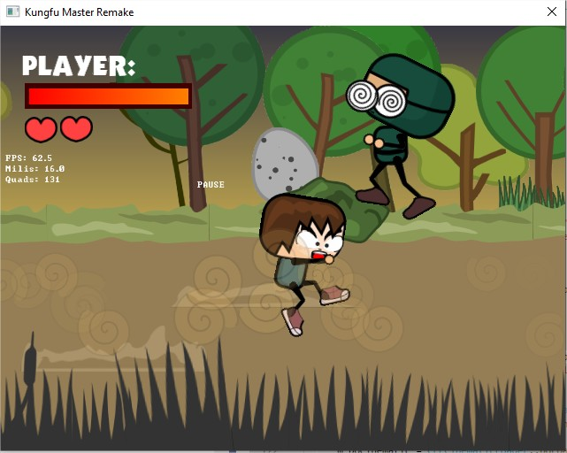
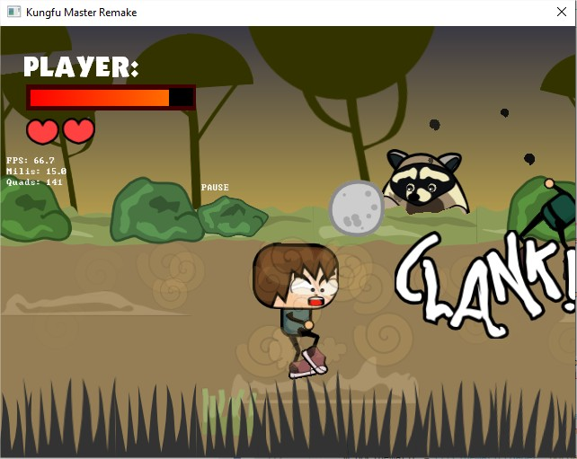
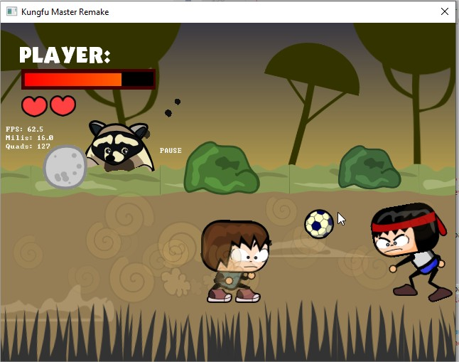
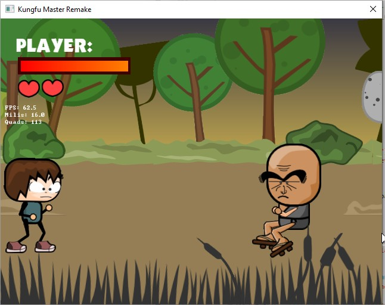

This is the root directory where the projects build with FuetEngine are located.
Create a directory here where your game project will be located.

All game projects share some functionality and tools. Inside the share directory you'll find anything that can be shared among all the projects.

Im the following weeks I'll be adding all the tools built using FuetEngine and for FuetEngine and eventually a sample complex project. For now there is the SpriteEditor, the ActorEditor (for skeletal 2D animations), Font Editor. Still missing the HUDEditor which along the years it became the most important tool while developing the games.

## KungFu master remake
This was the first project using FuetEngine, it started it all. Graphics style was simple vector style. You can find the project in the ```KungFuMasterRemake``` branch.









## FuetEngine Notes:

- From windows Environment, set environment variable ```FuetEngineProjectsDev``` to the root directory where all the development projects and shared directory is located.

- Some features may require external libraries. Those are expected to be found under 
```$(FuetEngineProjectsDev)/shared/sdks``` directory. For instance, almost all tools / projects use images, so if we're using a third party library to load images, it most probably will be found here.

- Although the engine allows plugin any other image loading library, I've been using ```FreeImage``` since the begining of the project. It should be found under ```$(FuetEngineProjectsDev)/sdks/FreeImage```, and its related files should be located under ```Dist``` directory inside the FreeImage folder. Before compiling any FuetEngine sample / tool or applicaton we should have a binary version of this library, so we'll have to build it. To ensure compatibility with the latest FuetEngine development state, a copy of the source code at that moment is provided, so you can build it by yourself.

- Quick overview. Go to the samples directory and open the solution found under build directory. Compile and test each sample.


### build instructions
In most cases you will need to use premake (included in ```$(FuetEngineProjectDev)/shared/toolchain/general```) to create the project files so you can build the binaries.

- Build FreeImage:
  - Premake5 vs2022 (or any other)
  - Generate the Debug or Release libraries for x64 or Win32
  - Premake5 install. 
    
- Build freealut.
  - Premake5 vs2022
  - Generate the Debug or Release libraries for x64 or Win32

- Build libConfigPortable
  - Premake5 vs2022
  - Generate the Debug or Release libraries for x64 or Win32

- Build wxWidgets2.8
  - Generate the Debug, Release, Unicode Debug, or Unicode Releaes libraries for x64 or Win32

Now you can build FuetEngine things:

- Build FuetEngine
  - Premake5 vs2022
  - Generate the Debug or Release libraries for x64 or Win32

- Build Samples
  - Premake5 vs2022
  - Generate the Debug or Release libraries for x64 or Win32

- Build Tools
  - Premake5 vs2022
  - Generate the Debug or Release libraries for x64 or Win32

Or you can switch to a specific branch and build one of the projects.


## Building on Linux (FuetEngine + samples)

Tested with gcc 15, premake 5.0.0 and an X11 / XWayland session. Sound is not supported on Linux yet (the dummy audio backend is used), and `2DisplaysSample` (wxWidgets 2.8) and `SoundSample` are not built.

1. Install premake5 (release 5.0.0 for Linux) and the development packages:

        sudo apt install libgl-dev libglu1-mesa-dev libopenal-dev
        git submodule update --init --recursive -- shared/src/sdks/externals/{libConfigPortable,FreeImage,physfs,freealut,OpenGL,OpenAL_1.1_SDK}

2. Build the external libraries. This produces `shared/toolchain/FuetEngine/linux-deps/{lib,include}`:

        shared/toolchain/linux/build_externals.sh

3. Build the engine:

        cd shared/src/FuetEngineFramework/FuetEngine
        premake5 --file=Premake5.lua gmake
        make -C build config=dev_debug_x64 -j$(nproc)

4. Build and run the samples (run them from the data folder):

        cd ../samples
        premake5 --file=Premake5.lua gmake
        make -C build config=debug -j$(nproc)
        cd data/PC && ../../exe/helloworld/Debug/helloworld

Notes:

- `ESC` or `F12` quit a sample. `FE_SAMPLE_FRAMES=N` makes it exit after N frames (useful with `xvfb-run`).
- The engine creates its own X11/GLX window when `Init` receives `NULL`. A host application (for instance a wxWidgets canvas) can render into its own window by passing a `TFELinuxWindow*` (see `FuetEngine/src/core/Linux/FECLinuxWindow.h`) to `CFERenderer::Init` and to the input initialization.
- After rebuilding the engine library, relink the samples with `make -B` (they do not depend on `libFuetEngine.a` in the makefile).
- Linux needs include paths with the exact case of the file names. `shared/toolchain/linux/fix_include_case.py` normalizes `#include "..."` lines (it was already run over the engine and the samples).
